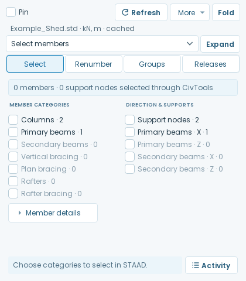

# CivTools

A Windows engineering workspace built with **PySide6 / Qt 6**. Five tools share
a compact launcher, independent utility windows, consistent controls and bundled
Poppins typography. The desktop no longer depends on Tkinter.

The launcher and utility windows use a shared set of original vector icons:
AutoCAD-style red drawing marks, distinct STAAD modeling marks, Excel/workbook
icons and document-library icons. Each tool has a small engineering workflow
illustration in its header. These visuals are drawn and cached in Qt at high-DPI
resolution; they do not load the older raster illustrations or require downloads.


## Run

Python 3.10 or newer, on Windows:

```powershell
python -m venv .venv
.\.venv\Scripts\python.exe -m pip install -r requirements.txt
.\.venv\Scripts\python.exe CivTools.py
```

AutoCAD and STAAD.Pro must be installed for the corresponding CAD operations.
Open the intended AutoCAD drawing or STAAD model before running a job. Pipe rack
generation requires a blank model. Pipe rack generation and AutoCAD plotting modify
the active CAD model; the parameter generator scans STAAD and creates a command
preview for review and export. The geometry preview is a modeling aid, not a
structural design check.

## Tools

- **Excel Report Publisher:** drop Excel files or a folder, inspect worksheets,
  choose automatic portrait/landscape with all report columns fitted to page
  width, preview the actual PDF, and publish individual, per-sheet and combined
  reports. Desktop Microsoft Excel is required. Supports `.xlsx`, `.xlsm`,
  `.xlsb` and `.xls`; source workbooks are never saved. Existing print areas,
  headers, numerical formats, diagrams and hidden content are preserved unless
  explicitly overridden. A4/A3, repeated headings, section break rows, margins,
  optional row-height repair and recalculation have sheet/workbook/batch settings.
  Saved presets can match sheet names plus their layout signatures in later batches.
  Exceptions are held for review; passwords are kept only for the current session.
  Use **Retry exceptions** after resolving a problem. Export retains relative
  folders, versions existing names, and writes an export summary. The last job
  restores after restart. Prepared PDFs stay in `%APPDATA%/CivTools/report-jobs/`
  so interrupted jobs and reviewed previews can be recovered.
  Workbooks with data connections or legacy macro sheets require a publishing
  copy without those features. External links are not refreshed; binary/legacy
  formats have limited saved-value preflight and are explicitly marked for review.
  See [publisher plan and implementation notes](docs/excel-report-publisher-plan.md).

- **DXF quantity extractor:** extract Approximate Quantities tables from model and
  paper space; preserve other drawings, track changes and consolidate material
  totals. Select an `.xlsx` or `.xlsm` mapping workbook, then choose an output
  workbook. Consolidation requires `Drawing_Structure_Mapping`. Work is staged in
  a temporary copy and committed only after success; VBA is preserved for `.xlsm`.
- **STAAD productivity suite:** Select, Renum, Groups, Releases, Dgn Prm,
  Tables, Load Comb, Plate Girders, Pipe Rack and PEB A-D. The complete concrete/
  steel parameter editor now lives under **Dgn Prm**, including presets and
  command validation. The complete rack modeler lives under **Pipe Rack**,
  including preview, saved configurations, live generation and `.std` export.
  Neither tool has a separate launcher card. No vendor account or server is used.
- **AutoCAD smart mapper:** choose a worksheet (the first is selected by default), with a header row followed
  by center X, center Y, width, height and optional label in columns A–E. Text
  height and offset use drawing units. A sample table and valid/invalid/blank counts
  use the same validation as plotting. Labels and geometry failures are reported separately.
- **EIL standards library:** select a local PDF folder; search and sort the table,
  inspect details, preview the first page and open the original document.

CAD calls run on a dedicated serial queue with COM-initialized workers, separate
from workbook and library workers. The active target, stages, percentage and elapsed
time appear alongside the job. Other tools remain usable during a job. Exiting the suite
is blocked while an engineering operation is running; there is no unsafe mid-job
cancellation of CAD changes. Errors and bounded activity logs appear inline.
The document browser has a metadata cache, a 12-image preview cache and only one
active preview render, with the latest selection queued. All PDF scanning and rendering
run in one isolated process. Previews render only when the Preview option is enabled.

Pipe rack tier elevations are **absolute**, including when the base is nonzero.
The preview and generator share the same geometry plan. Invalid inputs disable generation,
and the form shows node/beam estimates before connecting. Generation requires an open,
saved, empty STAAD model and checks its node/member counts before any changes. Models are
limited to 10,000 nodes and 30,000 beams. CAD failures may leave partial changes, which are
reported explicitly; inspect the active model before retrying.

## Navigation and data

The launcher opens at 780 × 700 with illustrated tool cards in a responsive grid.
Cards reflow from three columns to two in narrower windows, and search results
close gaps automatically. Each tool opens in its own resizable window, so you can use several
tools beside your CAD application and minimize the launcher independently.
**Keep on top** pins an individual tool. Closing a utility hides it and preserves
its inputs for **Resume**; an active job continues and its status appears in the
launcher. Exit through the launcher after jobs finish to close the entire suite.
Window geometry, form inputs, file-dialog folders, library location and preview preferences
also survive restarting the app. Text size can be set to 100%, 115% or 130% in the launcher.
Completed workbook jobs offer Open workbook and Show in folder; subsequent consolidation
uses the newly generated workbook.

`Ctrl+F` focuses search, `Escape` clears search and `Alt+Home` in a tool opens the
launcher. Previews and saved pipe rack configurations are optional expandable
sections. Drop DXF drawings onto the quantity extractor, or drop an Excel workbook
onto a workbook field. Select drawings to remove individual files from a batch.
Extraction and consolidation buttons become available when their required inputs
are selected.
Set `CIVTOOLS_TUTORIALS_PATH` to your local tutorial folder for the tutorials button.

Provision standards in `data/EIL STD/` beside the source entry point or executable,
or choose a different folder in the library. Engineering datasets are not bundled.
Settings, pipe rack configurations and PDF metadata are stored in
`%APPDATA%/CivTools/`. Legacy DJ settings in the source directory are read as a
fallback. The app does not log startup usage or send engineering data externally.
For portable/testing setups, `CIVTOOLS_CONFIG_DIR` overrides the settings directory.

## Build

```powershell
.\.venv\Scripts\pyinstaller.exe CivTools.spec
```

Distribute the **entire** `dist/CivTools/` directory and run `CivTools.exe` within
it. The directory build avoids decompressing the Qt runtime at each startup. UPX
is disabled. Fonts and their SIL Open Font License are included in the build.

## Verification

```powershell
.\.venv\Scripts\python.exe -m unittest discover -s tests -v
```

The tests cover engineering geometry, actual Open/Resume button clicks, responsive
card layout, Qt page construction and state preservation,
search, worker delivery on the UI thread, failure recovery, grid validation,
transactional workbook output, unchanged drawing preservation, consolidated totals
and PDF cache invalidation. Qt tests run with the offscreen platform. Actual CAD
integration still requires validation with installed AutoCAD/STAAD and real models.
`CivTools.exe --smoke-test` opens all four launcher tools offscreen and checks real rendering
in the isolated PDF process. Set `CIVTOOLS_SMOKE_REPORT` to save its JSON result.
Windows must permit local child processes for PDF tests and previews.

## Local STAAD productivity suite

Open **STAAD productivity suite** from the launcher. It opens a 420 x 480 floating
panel with a searchable tool selector, four favourites and the active task.
**Ctrl+K** focuses the tool selector. Choose a tool or type to find it, then Enter.
Switching tools preserves inputs. **PEB frames** is one section in the selector.
Choose **Frame A**, **B**, **C** or **D** inside it. Each variant keeps its inputs;
returning to the section restores the last variant, including after a restart.
**More ? Add / remove favourite** changes the shortcuts (up to four, saved).

**Pin** keeps the panel on top. **Fold** collapses it to a toolbar; **Unfold**
restores its size and inputs. **Expand** opens a larger editor for tables and
complex forms; **Compact** restores the floating size. Position and size are
remembered. Model name, units and cache state appear above the tool selector;
hover for the full path, source and member count. **Refresh** scans the active
model without changing tools.

Member tables, local-axis diagrams and command previews expand on demand.
Release review and apply controls stay visible below the scrolling form.
Design-parameter presets and enable controls are in **Presets**;
validation, copy and export are in **Commands**. Compact parameter tables show
Use, Parameter and Value, with the selected scope underneath. Expand restores
Scope and Description columns. Result exports use a result-type selector and
**Export Excel**; export actions stay below the scrolling form. Model changes still require
review and confirmation. **More ? Detach tool** remains available for a separate
editor; **Return to workbench** docks it again. Alt+S/N/G/R/M/T/L/E/P and
Alt+A/B/C/D retain the existing tool shortcuts.



- **Select members:** **Scan active model** caches the model. Category checkboxes
  show member counts and directly combine groups in STAAD. The searchable table
  lists member incidences, categories, midpoint elevations and lengths in the
  displayed model units. Primary beams span supported main-column stacks;
  vertical and roof bracing use connected geometry rules. Toggles verify selected
  IDs, avoid repeated scans, and batch STAAD redraws. Process again after geometry
  edits. Live selection checks the model path, counts and saved-file signature;
  it cannot detect every unsaved edit preserving those counts.
- **Renum:** preview and confirm floor/category numbering. Beams start at 1001,
  columns at 1501 and bracing at 1751 on the first floor; subsequent floors use
  separate blocks. Crowded floors use a larger block. The operation backs up the
  model, journals a collision-free plan, and verifies final incidences. Beam-only
  analytical models are supported; plates, solids and physical members are excluded.
- **Groups:** confirm creation of column-node, member, floor, primary/secondary
  beam and bracing groups. Exact generated `_RB` names can be replaced; unrelated
  user groups are preserved. Backups and post-write checks are retained.
- **Releases:** select beams in STAAD and **Scan active model**. Choose START/END
  and the local-axis DOFs beside the member incidence sketch, then **Review selected
  members**. The inline table lists affected ends and skipped-member reasons;
  the expandable command preview shows the exact STAAD commands. **Apply reviewed
  releases** remains visible in the footer and requires confirmation. Changing
  settings or refreshing the model clears the review. Complete
  supported straight physical chains receive releases only at exterior ends.
  Columns, braces, incomplete chains, tertiary framing, cantilevers and ambiguous
  branches are skipped with reasons. The reviewed selection must remain unchanged
  when Apply is confirmed.
- **Dgn Prm:** contains the full former parameter generator (Concrete, Steel,
  command Preview, presets, search and validation). An additional Automatic
  lengths & joints tab provides the documented three-button workflow. Its code
  selector supports IS 800:2007 (`LY/LZ/LX`) and IS 800:1984 (`LY/LZ/UNL`), with
  DJ1/DJ2 generation. Lengths are geometry-based restraint candidates requiring
  engineering review. Assign saves, backs up, closes and reopens the STD file,
  adds a numbered parameter block and restores the original input units. Existing
  design checks are preserved; defining parameters does not move earlier checks
  or infer a new design invocation.
- **Tables:** Load Cases lists primary cases and combinations. Move the required
  cases to Selected, then export reactions, displacements or pedestal forces.
  XLSX files contain signed data, summaries and genuine refreshable PivotTables;
  displacements also have per-level sheets, horizontal XZ and 3D resultants.
  Pedestal dimensions/height/density are editable spreadsheet inputs with force
  transfer formulas and retained torsion. Formula/pivot recalculation requires a
  compatible spreadsheet app. Excel itself was not used for automated validation.
- **Load Comb:** download the `LOAD_COMB` XLSX template, enter case numbers,
  symbols and types on rows 2-4 and combinations from row 5, select the file and
  Generate Output. The DOCX contains STAAD primary-case and combination scripts
  plus formatted tables. CSV long-form input is also supported. Factors are
  user-supplied; no code-dependent factor catalogue is assumed.
- **Plate Girders:** exports a STAAD USER TABLE catalogue of 142 built-up I
  sections, with optional custom dimensions in mm. Properties are calculated
  independently from rectangular plates, omitting welds and fillets. Use an unused
  user-table number when inserting the output.
- **Pipe Rack:** the full existing grid/tier modeler, preview, bracing, foundations,
  saved configurations and live generation are preserved here. Live generation
  requires a blank active model. Export STAAD file creates a standalone geometry
  file without modifying the active model.
- **PEB A-D:** standalone `.std` geometry wizards with dimensional sketches,
  metre/inch inputs, ridge height or roof slope where applicable, frame count,
  frame spacing, tie and purlin maximum spacing, and internal column spacings for
  variant C. A is gable, B adds ridge columns, C adds two internal columns, and D
  has a single-slope roof. Assign sections, materials and loads before analysis.

Processing is bounded to 10,000 nodes / 30,000 members and result exports to
100,000 node/case pairs. Model-changing workflows validate the complete snapshot,
request confirmation and create backups. Existing parameter/rack settings are
preserved under their prior settings keys. The guide and installed client supplied
workflow evidence; the vendor's remote algorithms are unavailable, so exact
algorithm/output equivalence is not claimed. See
`artifacts/dezignlink/inspection-report.md` for evidence and limitations.

After building, run `.\.venv\Scripts\python.exe scripts/verify_release.py` to check
both source and packaged startup, including a real PDF render. Run
`.\.venv\Scripts\python.exe scripts/package_release.py` to create the verified
`dist/CivTools-Windows.zip` archive and its SHA-256 checksum. Local geometry and
worksheet timings can be recorded with `scripts/benchmark.py`; these do not
measure live CAD performance.

## Source layout

`src/civtools/qt_app.py` owns the launcher and utility windows; `qt_pages.py` implements
tool workflows; `qt_style.py` and `qt_widgets.py` define shared visuals;
`qt_artwork.py` draws the integration marks, illustrations and action icons;
`jobs.py` owns background jobs and file operations; `core/` contains UI-independent
engineering algorithms. The previous module paths expose compatibility imports
for the extracted services and pipe rack generator.
